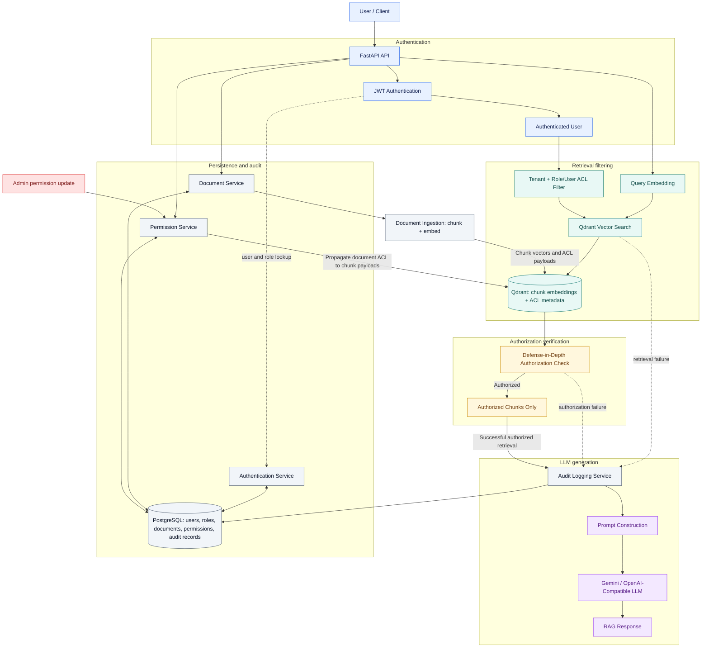

# Permission-Aware Multi-Tenant RAG

[](https://www.python.org/)
[](https://fastapi.tiangolo.com/)
[](https://www.postgresql.org/)
[](https://qdrant.tech/)
[](https://docs.docker.com/compose/)
[](https://pytest.org/)
[](https://github.com/GOKULNAIK18/permission-aware-multi-tenant-rag/actions/workflows/ci.yml)

A portfolio project demonstrating a permission-aware, multi-tenant Retrieval-Augmented Generation (RAG) API. It treats authorization as part of retrieval: the caller's verified identity constrains vector search, and every returned chunk is checked again before it can enter an LLM prompt.

PostgreSQL stores tenants, users, document permissions, and audit metadata. Qdrant stores embedded document chunks and their ACL payloads. Sentence Transformers generates local embeddings. Answer generation can use a deterministic mock or a configured OpenAI-compatible provider such as Gemini.

## Architecture



Unauthorized chunks are filtered before/at vector retrieval and are checked again before prompt construction. Only authorized context is allowed to reach the LLM.

### RAG request flow

1. FastAPI verifies the JWT and resolves an active database user. Tenant and role identity come from the authenticated identity and database, not request-body fields.
2. The service embeds the question and constructs a Qdrant filter requiring the authenticated tenant and either an allowed role or explicit user ACL.
3. Qdrant applies that filter as part of vector retrieval, before returning matches.
4. The application validates every payload and checks authorization again. An unexpected, malformed, or unauthorized result fails closed and is never added to a prompt.
5. The service writes the required audit event, builds a prompt using only authorized chunks, calls the configured LLM, and returns the answer with chunk references.

If no authorized chunks are found, the API returns `No authorized documents were found.` and skips the LLM call. A required audit write happens before prompt creation or generation; an audit failure also prevents generation.

### Permission update flow

An authenticated tenant ADMIN selects a document scoped to their tenant. The service temporarily sets its matching Qdrant chunks to deny-all, commits the new PostgreSQL permissions, and synchronizes the ACL payloads. The next query uses the changed permissions without re-embedding the document. If synchronization fails, the service reports the failure and attempts to leave the document denied.

## Security architecture

- **JWT-derived identity:** protected routes verify signature and expiry, resolve an active user, and check token roles against database roles.
- **Tenant isolation:** every chunk must carry a tenant ID. Qdrant filters on the authenticated tenant, and the application checks the tenant again after retrieval.
- **Role and user ACLs:** within a tenant, a matching allowed role **or** an explicit allowed user grants access. Classification is retained and validated as metadata; it does not independently grant access.
- **Two authorization checks:** Qdrant pre-filtering limits candidates before retrieval; application-level authorization rejects unexpected results before prompt construction.
- **Fail closed:** malformed payloads, unexpected fields, unknown roles or classifications, and unauthorized chunks trigger an audited security failure. No partial prompt is sent to the LLM in that case.
- **Untrusted retrieved text:** prompt instructions treat document text as data, not instructions. Prompt wording is defense in depth; ACL enforcement is the access boundary.
- **Auditing:** RAG success and failure paths use a unique request ID. Query content is redacted in audit storage; prompts, answers, credentials, JWTs, and retrieved text are excluded. Permission events record metadata and counts, not document content.
- **Permission revocation:** deny-all during synchronization prevents a stale grant from being used while PostgreSQL and Qdrant are updated.
- **No answer cache:** answer caching is not implemented. Any future cache must include tenant and user or permission-version context.

## Security Demonstration

| Scenario | Identity | Expected behavior | Verified result |
|---|---|---|---|
| Authorized access | Alice — ACME, ADMIN | Retrieve the protected ACME ADMIN document and answer from authorized context. | Alice retrieved document 7; Gemini generated an answer from the authorized context. |
| Role-based denial | Bob — ACME, EMPLOYEE | The same query cannot retrieve the ADMIN-only document. | Response: `No authorized documents were found.` |
| Cross-tenant isolation | Globex employee | Cannot retrieve the protected ACME document. | Cross-tenant retrieval is blocked. |
| Identity tampering protection | Bob — ACME, EMPLOYEE | The JWT remains the source of identity; fake `tenant_id`, `user_id`, or `roles` in the request body do not grant access. | Request-body identity tampering is blocked. |
| Permission revocation | User previously allowed to access document 7 | After permissions are revoked, document 7 is absent from subsequent retrieval results. | Revocation takes effect on the next query. |
| LLM prompt boundary | Authorized and unauthorized test users using deterministic `CapturingLLM` | Unauthorized content is excluded from the prompt; authorized content is included. | The test confirms the marker is absent for unauthorized access and present for authorized access. It tests the application's LLM boundary; it does not inspect Gemini's internal request. |
| Automated validation | Full test suite and security selection | Validate the security scenarios without live LLM credentials or requests. | 128 total tests passed; 108 security tests passed. No real Gemini/OpenAI calls are required for the automated security suite. |

### Security boundary

```text
JWT identity
→ tenant/ACL pre-filter
→ vector retrieval
→ defense-in-depth authorization
→ authorized context only
→ LLM
```

## Technology stack

| Area | Technology |
|---|---|
| API | Python 3.13, FastAPI, Pydantic |
| Relational storage and migrations | PostgreSQL, SQLAlchemy, Alembic |
| Vector retrieval | Qdrant, tenant and ACL payload filters |
| Embeddings | Sentence Transformers, `sentence-transformers/all-MiniLM-L6-v2` by default |
| LLM | Deterministic mock or configurable OpenAI-compatible client; Gemini endpoint is supported |
| Authentication | Signed JWTs and password hashing |
| Containers and CI | Docker Compose, GitHub Actions |
| Tests | pytest, deterministic embedding/LLM doubles, in-memory Qdrant for relevant tests |

## Project structure

```text
app/
├── api/                 # authentication, documents, RAG, and permissions routes
├── auth/                # JWT identity, password hashing, and ACL helpers
├── core/                # configuration and shared settings
├── db/                  # SQLAlchemy base and database session
├── models/              # tenant, user, document, ACL, and audit models
├── schemas/              # request and response validation
└── services/             # ingestion, retrieval, audit, permissions, and LLM
alembic/                  # database migration environment and revisions
benchmarks/               # benchmark harness and saved Milestone 12 results
data/                     # fictional seed documents
scripts/                  # local demo data seeder
tests/                    # API, unit, permission, and security tests
.github/workflows/ci.yml  # GitHub Actions workflow
Dockerfile
docker-compose.yml
requirements-runtime.lock
requirements-dev.lock
README.md
```

## API endpoints

FastAPI serves interactive Swagger documentation at `/docs` and the schema at `/openapi.json`.

| Method and path | Authentication | Purpose |
|---|---|---|
| `GET /` | None | Basic service information. |
| `GET /health` | None | Health check. |
| `POST /auth/login` | None | Authenticate a seeded/local user and issue a Bearer token. |
| `GET /protected` | Bearer JWT | Return the authenticated identity as a diagnostic. |
| `POST /documents/upload` | Bearer JWT, ADMIN | Upload a document with optional classification and ACL metadata. Tenant comes from the verified identity. |
| `PATCH /documents/{document_id}/permissions` | Bearer JWT, ADMIN | Change a same-tenant document's role/user ACL and classification. |
| `POST /rag/query` | Bearer JWT | Query authorized document chunks and generate an answer. Request fields are `question` and optional `limit` (1–20, default 5). |

RAG responses contain the answer and retrieved chunk references (IDs and scores). No endpoint accepts request-body tenant or role values as authorization identity.

## Local setup

### Prerequisites

- Python 3.13.
- Docker Desktop or Docker Engine with Docker Compose v2.
- Git.

Clone the repository, create a virtual environment, install the development lock file, and copy the safe example configuration:

```sh
git clone https://github.com/GOKULNAIK18/permission-aware-multi-tenant-rag.git
cd permission-aware-multi-tenant-rag
python3.13 -m venv .venv
source .venv/bin/activate
python -m pip install --requirement requirements-dev.lock
cp .env.example .env
```

Edit `.env` locally. Set `POSTGRES_PASSWORD`, make both database URLs use the same password, and set `JWT_SECRET` to a randomly generated secret of at least 32 bytes. Keep `.env` private; Git and Docker build context ignore it. The example defaults to `LLM_PROVIDER=mock`, so the Gemini key placeholder is not needed for local mock use.

Start the local services, migrate the database, seed fictional demo users/documents/ACL records, and launch the API:

```sh
docker compose up -d postgres qdrant
alembic upgrade head
python scripts/seed_demo.py
uvicorn app.main:app --host 127.0.0.1 --port 8000
```

Visit `http://127.0.0.1:8000/docs` or check health with:

```sh
curl --fail http://127.0.0.1:8000/health
```

The seeder creates fictional local-only demo accounts with fixed, public sample credentials. Do not use them in a deployed environment. The seeder does not print password values. The first embedding operation may download the configured model weights.

### LLM configuration

Mock generation is the safe default for tests and local security checks. To use Gemini through Google's OpenAI-compatible API, set these variables in the private `.env`:

```dotenv
LLM_PROVIDER=openai-compatible
LLM_BASE_URL=https://generativelanguage.googleapis.com/v1beta/openai/
LLM_MODEL=gemini-3.8-flash
LLM_API_KEY=your_Gemini_API_key
LLM_TIMEOUT_SECONDS=60
```

The key is read from environment configuration. Never commit it or put it in logs, API responses, or screenshots. Automated tests use a deterministic mock or intercepted HTTP transport and do not make a live LLM request. To switch back to the mock, set `LLM_PROVIDER=mock`.

### Docker Compose

Compose provides the FastAPI app, PostgreSQL, and Qdrant. Published ports bind to loopback, services use internal hostnames (`postgres` and `qdrant`), health checks gate startup, and database/vector/model data use named volumes. Migrations are an explicit command:

```sh
docker compose up -d postgres qdrant
docker compose run --rm app alembic upgrade head
docker compose up --build -d app
docker compose ps
curl --fail http://127.0.0.1:8000/health
```

For an isolated Compose project using alternate host ports, run:

```sh
POSTGRES_PORT=15432 QDRANT_PORT=16333 APP_PORT=18000 docker compose -p rag-local-check --env-file .env up -d postgres qdrant
POSTGRES_PORT=15432 QDRANT_PORT=16333 APP_PORT=18000 docker compose -p rag-local-check --env-file .env run --rm app alembic upgrade head
POSTGRES_PORT=15432 QDRANT_PORT=16333 APP_PORT=18000 docker compose -p rag-local-check --env-file .env up --build -d app
curl --fail http://127.0.0.1:18000/health
```

This creates project-scoped named volumes. Only remove those resources when finished; `docker compose -p rag-local-check down -v` deletes that project's volumes.

## Testing and validation

The latest recorded local verification for this project completed with:

- **128 passed** in the complete pytest suite.
- **108 passed** in the explicit security/adversarial test selection.
- The security selection includes tenant isolation, role and user ACLs, Qdrant pre-filtering, application-level authorization, request identity tampering, permission revocation, audit behavior, leakage/adversarial cases, and unauthorized content never reaching the LLM.
- Security-boundary tests use deterministic test clients; no real Gemini/OpenAI request is needed.

These are recorded local results, not a claim that tests were run as part of editing this README. To run tests after starting PostgreSQL and applying migrations:

```sh
docker compose up -d postgres
alembic upgrade head
pytest -q
```

To run the focused security group:

```sh
pytest -q tests/test_adversarial_security.py tests/test_permissions.py tests/test_leakage.py tests/test_acl.py tests/test_rag.py tests/test_audit.py
```

GitHub Actions is configured to install dependencies, start PostgreSQL and Qdrant, run migrations, and execute both the full test suite and security tests using test-only credentials and the mock provider. The workflow configuration was validated locally; a successful remote Actions run should be confirmed from the repository's Actions page.

## Saved benchmark results

The figures below are the saved Milestone 12 benchmark run from 2026-09-29, not a new run. The machine was an Apple M1 with 8 GB RAM using Python 3.13.1 on macOS 27.0.1. Data and identities were synthetic (two tenants, four users, three roles; datasets of 100, 1,000, and 5,000 chunks). Repeated measurements used n=30 after five warmups. The run used Qdrant client 1.19.1 and Docker server 1.13.2; current Compose uses server 1.19.1. Values therefore describe that recorded setup, not current deployment performance.

| Measurement | Backend / size | Median (ms) | p95 (ms) | n |
|---|---|---:|---:|---:|
| Tenant + role/user ACL search | In-memory, 100 chunks | 1.360 | 1.639 | 30 |
| Tenant + role/user ACL search | In-memory, 1,000 chunks | 9.919 | 10.638 | 30 |
| Tenant + role/user ACL search | In-memory, 5,000 chunks | 47.108 | 49.223 | 30 |
| Tenant + role/user ACL search | Docker Qdrant 1.13.2, 100 chunks | 2.360 | 3.026 | 30 |
| Tenant + role/user ACL search | Docker Qdrant 1.13.2, 1,000 chunks | 2.315 | 3.068 | 30 |
| Tenant + role/user ACL search | Docker Qdrant 1.13.2, 5,000 chunks | 2.501 | 3.282 | 30 |
| Authorized HTTP RAG with audit | Docker Qdrant 1.13.2, TestClient | 25.226 | 31.996 | 30 |

Permission propagation was measured once per backend (n=1), so these are individual observations, not distributions:

| Backend | Revoke update (ms) | Next query denied (ms) | Grant update (ms) | Next query granted (ms) |
|---|---:|---:|---:|---:|
| In-memory Qdrant | 19.516 | 25.457 | 13.211 | 21.976 |
| Docker Qdrant 1.13.2 | 25.294 | 35.651 | 20.815 | 32.701 |

The benchmark made no external LLM calls. HTTP measurements use FastAPI `TestClient`, not network load against a deployed API. Synthetic local measurements and n=1 propagation samples do not establish production capacity or an SLA. Full historical data: [`benchmarks/results_latest.md`](benchmarks/results_latest.md) and [`benchmarks/results_latest.json`](benchmarks/results_latest.json). Run `python -m benchmarks.run` only when intentionally refreshing Milestone 12 results; it overwrites the saved result files.

## Security notes and limitations

This project demonstrates application-level controls and regression tests; it is not a formal security certification or a claim of production deployment. The vector store is treated as untrusted, and a retrieval boundary failure aborts before prompt generation. API errors do not return provider credentials. Provider diagnostics are handled without exposing authorization headers or API keys.

Known scope limits:

- Seed users/documents are fictional demo data; the seed accounts and fixed sample passwords are for isolated local development only.
- Benchmark data is synthetic and hardware-specific. The saved Qdrant Docker version differs from the currently configured Compose server.
- Tests use in-memory Qdrant in relevant security cases; they do not represent a distributed production deployment.
- The audit log is append-only through application interfaces, but database-level immutability and external audit retention are outside this demo's scope.
- Gemini generation requires a user-provided key and network access. Automated tests do not call Gemini.
- Model weights may be downloaded on first embedding use.
- GitHub Actions workflow configuration is present, but remote workflow success must be checked on GitHub.

## Potential future improvements

- Add reproducible load tests against a deployed PostgreSQL/Qdrant stack with larger and more varied datasets.
- Add database-level controls and retention/export policies for audit records.
- Add operational metrics and traces for retrieval, authorization rejection, and permission synchronization.
- Document and exercise backup, restore, key rotation, and production secret-management procedures.
- Add deployment-specific readiness checks and multi-replica migration coordination.

## License

No `LICENSE` file is currently included, so the repository does not explicitly grant reuse or redistribution rights.

## Why this project?

This project explores a practical security problem in RAG systems: a model cannot leak a document it never receives, but vector search alone does not establish who is allowed to receive it. The implementation connects JWT identity, tenant-scoped ACL filters, a second authorization check, permission revocation, and audit behavior, then tests the actual prompt boundary with deterministic clients. It is designed to make those engineering choices reviewable through code, tests, Docker Compose, CI configuration, and recorded—not fabricated—benchmark results.
